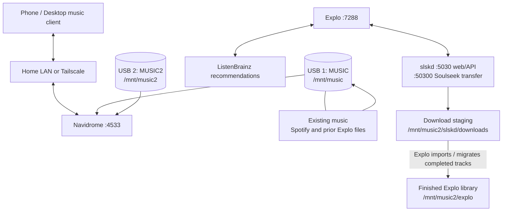

# Raspberry Pi Music Server — Architecture

This document describes the current known layout of the Raspberry Pi music server. It is intended for the `docs/architecture.md` file in the GitHub repository.

> **Configuration note:** This reflects the last configuration shared during setup. After making changes, verify actual container mounts with the commands in [Verification and troubleshooting](#verification-and-troubleshooting). Do not commit credentials, API tokens, personal listening data, or private music to GitHub.

## 1. Overview

The system uses a Raspberry Pi to host a personal music library and music-discovery workflow:

- **Navidrome** streams music to compatible web and mobile clients.
- **Explo** imports playlist recommendations and coordinates track searches/downloads.
- **slskd** provides the Soulseek search and download service used by Explo.
- **Two USB drives** separate the original music collection from newer downloads and finished Explo-managed music.
- **Tailscale** provides remote access without relying on the Pi's changing local-network IP address.

## 2. Architecture diagram



The diagram shows the intended data flow. Actual playlist availability still depends on ListenBrainz generating the requested playlist, and actual downloads depend on available Soulseek results and slskd's response.

## 3. Services

| Service | Container name | Port | Purpose |
|---|---|---:|---|
| Navidrome | `navidrome-navidrome-1` | `4533` | Music streaming, library indexing, and playlist access |
| Explo | `explo` | `7288` | Playlist import, music discovery, and download workflow |
| slskd | `slskd` | `5030`, `50300` | Soulseek web/API interface and transfers |

The services run in Docker. Explo reaches slskd through the Docker service hostname `slskd` on port `5030`, rather than through the Pi's LAN IP.

### Local and remote access

The Pi's LAN address has changed in the past; check it at any time with `hostname -I`. For example, a previously observed LAN address was `192.168.1.76`.

The previously observed Tailscale address was `100.101.186.102`. Confirm the current address before relying on it.

| Service | LAN URL pattern | Tailscale URL pattern |
|---|---|---|
| Navidrome | `http://<PI-LAN-IP>:4533` | `http://<PI-TAILSCALE-IP>:4533` |
| Explo | `http://<PI-LAN-IP>:7288` | `http://<PI-TAILSCALE-IP>:7288` |
| slskd | `http://<PI-LAN-IP>:5030` | `http://<PI-TAILSCALE-IP>:5030` |

Do not expose these ports directly to the public internet. Use Tailscale or another properly secured remote-access method.

## 4. Storage layout

Both USB drives are formatted as FAT32/VFAT and mounted using `/etc/fstab`.

| Drive | UUID | Mount point | Intended role |
|---|---|---|---|
| `MUSIC` (USB 1) | `EC17-CFEB` | `/mnt/music` | Existing music and older files |
| `MUSIC2` (USB 2) | `784C-A777` | `/mnt/music2` | New downloads and completed Explo-managed music |

Expected directories on USB 2:

```text
/mnt/music2/
├── slskd/
│   ├── downloads/      # Completed Soulseek transfer staging area
│   └── incomplete/     # Intended location for incomplete transfers
└── explo/              # Finished Explo-managed library
```

### Important note about incomplete downloads

The current known Compose file maps `/mnt/music2/slskd/downloads` to `/app/downloads`, but does **not** map `/mnt/music2/slskd/incomplete` to `/app/incomplete`. slskd's `/app` is mapped to `~/explo/slskd`, so incomplete transfer data may still be stored on the Pi's filesystem under `~/explo/slskd/incomplete`. To put incomplete transfer data on USB 2, add the following volume to the `slskd` service and recreate the container after checking the Compose file:

```yaml
- /mnt/music2/slskd/incomplete:/app/incomplete
```

Only do this once existing incomplete transfers have been safely preserved. Do not assume the mapping is active until `docker inspect slskd` confirms it.

### Filesystem considerations

The USB drives are FAT32/VFAT. The UTF-8 mount option was added to support filenames containing characters such as curly apostrophes. FAT32 also has a **4 GB maximum file-size limit** and is less suitable for Linux server data than ext4. Do not reformat existing drives without a verified backup; consider a Linux-native filesystem for a future storage migration.

## 5. Docker volume mappings

### Explo (`~/explo/docker-compose.yaml`)

Known mappings:

| Host path | Container path | Purpose |
|---|---|---|
| `/mnt/music2/explo` | `/data` | Finished Explo-managed tracks |
| `/mnt/music2/slskd/downloads` | `/slskd` | Explo access to slskd's download files |
| `~/explo/.env` | `/opt/explo/.env` | Explo configuration; private |
| `~/explo/config` | `/opt/explo/config` | Explo configuration/state |

Explo is published on port `7288` and configured with `restart: unless-stopped`.

### slskd (`~/explo/docker-compose.yaml`)

Known mappings:

| Host path | Container path | Purpose |
|---|---|---|
| `~/explo/slskd` | `/app` | slskd application data and configuration |
| `/mnt/music2/slskd/downloads` | `/app/downloads` | Download destination on USB 2 |
| `~/explo/slskd-credentials.env` | Environment settings (via `env_file`) | Private Soulseek credentials and API key |

slskd runs as UID/GID `1000:1000`, publishes ports `5030` and `50300`, and uses `restart: unless-stopped`.

### Navidrome (`~/navidrome/docker-compose.yml`)

Known mappings:

| Host path | Container path | Purpose |
|---|---|---|
| `~/navidrome/data` | `/data` | Navidrome database and application data |
| `/mnt/music` | `/music` (read-only) | Existing library drive |
| `/mnt/music2` | `/music2` (read-only) | New drive, including the Explo library |

Navidrome runs on port `4533` with `restart: unless-stopped`.

**Library configuration:** Mounting a directory into the container does not automatically make it a Navidrome library root. Configure the intended roots in Navidrome. In particular, use `/music2/explo` for the new completed-music library rather than `/music2`, if the goal is to avoid indexing staging downloads under `/music2/slskd/downloads`. Review the first drive's library roots too: scanning all of `/music` also exposes its `slskd/downloads` staging directory, which can result in duplicate tracks.

## 6. Music and playlist flow

1. ListenBrainz receives listening history from configured scrobbling clients.
2. ListenBrainz must generate a recommendation playlist before Explo can import it. Recent scrobbles alone do not guarantee that playlists such as Daily Jams or Weekly Exploration are available.
3. Explo attempts to fetch the configured playlist and sends eligible missing-track searches to slskd.
4. slskd downloads to `/mnt/music2/slskd/downloads` via the container path `/app/downloads`.
5. Explo reads staging files via `/slskd` and stores its finished library files under `/mnt/music2/explo` via `/data`.
6. Navidrome indexes configured library roots and serves tracks and playlists to compatible clients.

The known Explo schedules include Daily Jams (daily), Weekly Jams (Monday), Weekly Exploration (Tuesday), and On Repeat (monthly). Check the current `.env` for exact cron expressions and flags before relying on a schedule. Explo cannot import a ListenBrainz playlist that has not been generated upstream.

## 7. Startup, shutdown, and routine checks

### Start Explo and slskd

```bash
cd ~/explo
docker compose config -q
docker compose up -d
```

### Start Navidrome

```bash
cd ~/navidrome
docker compose config -q
docker compose up -d
```

### Check the containers

```bash
docker ps
```

slskd may display `health: starting` for a short time after a restart. Confirm it eventually becomes `healthy`.

### Check the drives

```bash
lsblk -f
df -h /mnt/music /mnt/music2
mount | grep -E '/mnt/music(2)? '
```

### Check actual Docker mounts

```bash
docker inspect slskd --format '{{range .Mounts}}{{println .Source "->" .Destination}}{{end}}'
docker inspect explo --format '{{range .Mounts}}{{println .Source "->" .Destination}}{{end}}'
docker inspect navidrome-navidrome-1 --format '{{range .Mounts}}{{println .Source "->" .Destination}}{{end}}'
```

### View logs

```bash
docker logs --tail 50 explo
docker logs --tail 50 slskd
docker logs --tail 50 navidrome-navidrome-1
```

### Shut down safely

```bash
sudo shutdown -h now
```

Wait for the Pi to shut down fully before removing power or disconnecting USB storage.

## 8. Troubleshooting notes

### slskd web page does not load

Test from the Pi:

```bash
curl -I http://127.0.0.1:5030
```

An HTTP response indicates the service is answering locally. Then check the current LAN address with `hostname -I`, confirm Tailscale is connected when remote, and check `docker logs --tail 50 slskd`.

### Downloads fail with `Invalid argument`

A prior issue was caused by a FAT32/VFAT mount that used ASCII filename handling. The `utf8` mount option allowed filenames containing curly apostrophes to be created. Confirm both drives mount with the expected options and test filenames before retrying downloads.

### A song appears but will not play

Check whether the file can be parsed by FFmpeg (`ffprobe`) and examine Navidrome logs while requesting playback. A valid audio file does not rule out client or transcoding configuration issues.

### A recommendation playlist is missing

Check whether the playlist exists in ListenBrainz first. Explo cannot fetch a playlist that ListenBrainz has not generated. Recent scrobbles do not guarantee the recommendations page is ready.

### A song appears more than once

Check whether Navidrome is indexing both the completed library and slskd's staging directories. Configure library roots to include finished music locations only, where practical.

## 9. Security and backup

- Never commit `~/explo/.env`, `~/explo/slskd-credentials.env`, password inventories, API tokens, or real passwords.
- Keep `UI_USERNAME` and `UI_PASSWORD` configured for Explo. The logs previously showed authentication disabled; verify this has been corrected before exposing port `7288` to any network beyond trusted access.
- Keep slskd and Navidrome behind trusted LAN/Tailscale access; do not expose them directly to the public internet.
- Keep a private backup of Docker Compose files and application configuration.
- Back up Navidrome's database and music separately. Two USB drives in the same Pi are additional capacity, not a full backup strategy.
- The credential inventory file should be local and private (`chmod 600`); don't add it to GitHub.
- Before publishing this repository, inspect its history and all staged files to ensure no secrets or private data have been committed.

## 10. Future improvements

- Put incomplete slskd downloads on USB 2 with an explicit `/app/incomplete` volume mapping.
- Set up automated backups of configuration and Navidrome data to a separate device or remote destination.
- Consider ext4 for a future Linux-oriented drive, with a verified backup and migration plan first.
- Pin known-working image versions rather than relying indefinitely on `latest` tags.
- Add health checks and alerts for disk space, missing mounts, and failed playlist imports.
